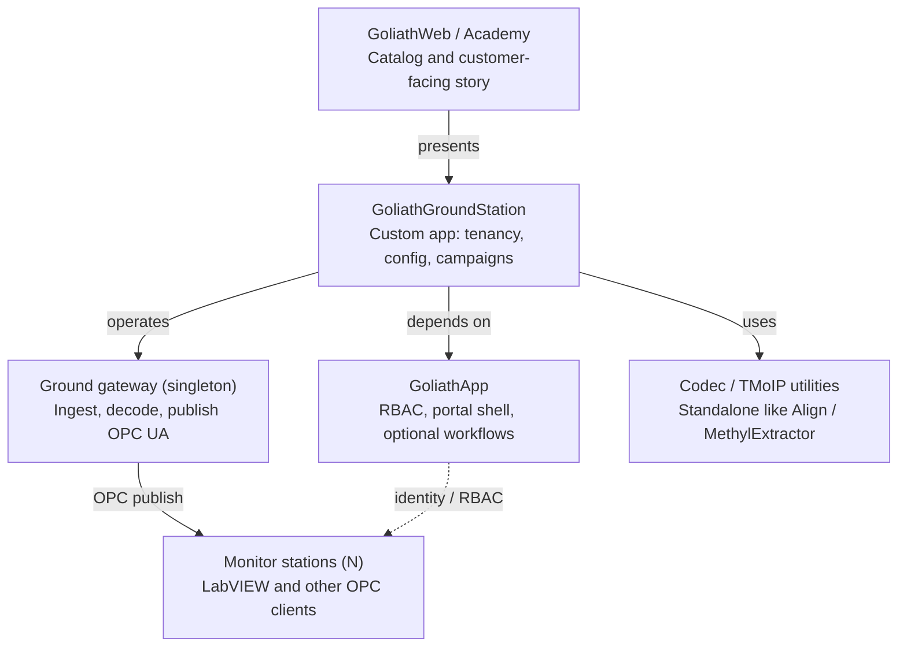
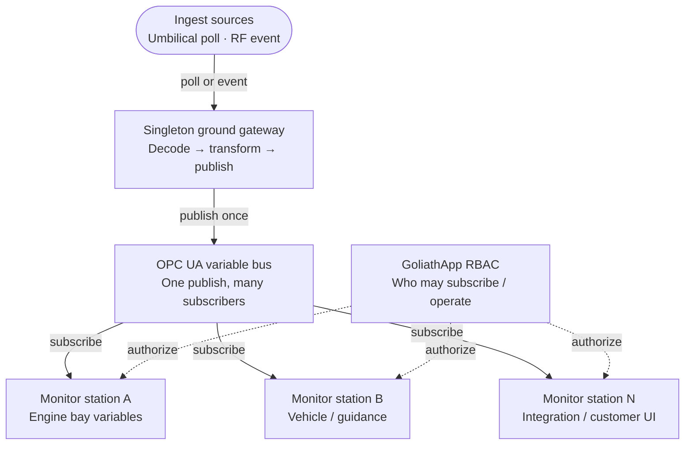
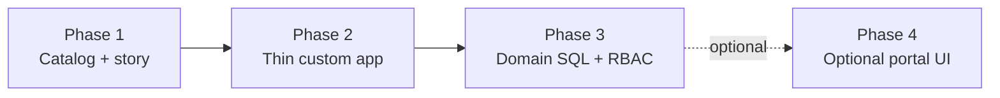

# GoliathGroundStation conversion plan

Customer-facing plan: how Astra becomes a GoliathApp specialization with a singleton rocket gateway, OPC fan-out to N monitor stations, and platform security without turning live telemetry into task workers.

**Sources:** [astra-ground-station-py](https://github.com/Goliath-Research/astra-ground-station-py), [GoliathApp](https://github.com/Goliath-Research/GoliathApp), [GoliathOmics](https://github.com/Goliath-Research/GoliathOmics), [GoliathWeb](https://github.com/Goliath-Research/GoliathWeb).

## What we can deliver

**Positioning.** GoliathGroundStation is the airspace / launch-ops specialization of GoliathApp — the same platform pattern as GoliathOmics for genomics — while the live rocket path stays publish/subscribe, not claim/submit workers.

A potential customer sees one product under Goliath Research: operator identity and tenancy from GoliathApp, a singleton ground gateway that ingests umbilical or over-the-air telemetry, and any number of LabVIEW or web monitor stations that subscribe to OPC UA variables.

| Capability | Customer value | Platform role |
| --- | --- | --- |
| Singleton rocket gateway | One trusted ingest path for umbilical poll and RF events | Domain service (not a workflow worker) |
| OPC UA variable bus | LabVIEW and other UIs see the same live tags | Publish once; N subscribers |
| N monitor stations | Scale with engines and vehicle variables | OPC clients; optional RBAC who may connect |
| Configurator and test campaigns | Integration and pre-launch configuration | App UI now; DomainPrograms later for batch jobs |
| Operator security | Sessions, roles, audit without task queues | GoliathApp RBAC / portal shell |

## Architecture

### Product map

Dependency direction matches GoliathOmics: the custom app depends on GoliathApp; realtime utilities do not depend on the app.



### Today (Astra)

Today: `astra-ground-station-py` is a self-contained ground station (Python services + Postgres config/testlog). It does not sit on GoliathApp.

```mermaid
flowchart LR
  rocket(["Vehicle\nUmbilical or RF"])
  tmoip["astra.tmoip\nMinor-frame reassembly"]
  bridge["astra.bridge\nUDP + embedded OPC UA"]
  web["astra.web\nConfigurator / test manager"]
  db[(PostgreSQL\nconfig + testlog)]
  lv["LabVIEW / UIs\nOPC subscribers"]
  exp["astra.exporter\nJobs → testlog"]
  rocket -->|frames| tmoip
  tmoip -->|id || body| bridge
  bridge -->|OPC UA tags| lv
  web -->|psycopg| db
  bridge -.->|config / jobs| db
  exp -->|testlog| db
  web -.->|ops API| bridge
```

### Live data path

**Design rule.** The gateway is a singleton. After ingest, data is published once as OPC network variables. Monitor count scales with engines and vehicle variables. Those stations are not workers waiting for tasks — at most they use platform security for who may connect.



### Target

Target: GoliathGroundStation owns the product surface and domain SQL; GoliathApp supplies identity and optional batch workflows; realtime daemons stay sibling services.


### Delivery milestones

Four delivery phases a customer can buy as milestones. Live telemetry never moves into the worker claim loop.



## Phased conversion

1. **Phase 1 — Catalog and customer narrative**  
   Add GoliathGroundStation to GoliathWeb via `.goliath/product.json` (`dependsOn: goliathapp`). Docs site and Academy link. No runtime change to the live path. Days of work; immediate sales collateral.

2. **Phase 2 — Thin custom app around existing Astra services**  
   This repository owns packaging and deploy profiles. Keep `astra.bridge` / `tmoip` / `web` / `exporter` as sibling systemd units. Wire operator login to GoliathApp sessions where useful. Weeks.

3. **Phase 3 — Domain ownership and security**  
   Move config/testlog schema ownership under the custom app (Omics-style domain SQL). Apply RBAC to who may operate the configurator and which OPC tag trees a station may see. Optionally DomainProgram-ize exporter and campaign jobs only. Months.

4. **Phase 4 — Portal UI (optional)**  
   Replace or wrap the FastAPI configurator with the Goliath portal shell. Buy only if the customer wants one chrome across Omics and ground station. Large UX effort; not required for live ops.

### In scope early

- Singleton gateway process
- OPC publish once, N monitors
- Platform identity without task queues
- Batch export / campaign workflows later

### Explicitly out of scope for the live path

- Turning the bridge into a claim/submit worker
- Rewriting the ~350KB config schema into Meta on day one
- Forcing LabVIEW through the workflow engine
- One monitor process per variable as a leased task

### Rough effort bands

| Phase | Effort |
| --- | --- |
| Phase 1 | Days — collateral ready |
| Phase 2 | Weeks — runnable product shell |
| Phase 3 | Months — domain + security depth |
| Phase 4 | Large optional — portal chrome |

## What stays outside the workflow engine

GoliathApp workers wait for leased ACTION nodes. The ground gateway does not. It either polls the vehicle on the umbilical or receives an over-the-air transmission as an event, then publishes OPC variables. Monitor stations subscribe; their count tracks engines and vehicle variables, not a worker pool size.

For optional batch work only (not the live OPC path): **notify via pub/sub, own via claim** — a pub/sub wake can signal that work is ready while DomainProgram workers still take ownership through the claim loop. Umbilical poll remains the safety net for ingest timing. The OPC telemetry bus stays separate from that activation path.

- **Use GoliathApp for security and tenancy**
  - Operator sessions and roles
  - Which stations may subscribe to which tag trees
  - Audit of configuration changes
- **Use DomainPrograms only for true batch work**
  - Test-log export jobs
  - Fixture / oracle campaigns
  - Config promote between sites
- **Keep as long-running domain services**
  - Singleton bridge / gateway
  - TMoIP reassembly
  - Embedded OPC UA server
  - Live configurator API until Phase 4

## Customer deliverables checklist

Status as of the plan date — mark done when a phase ships.

- [x] Product page and dependsOn hierarchy on GoliathWeb (Phase 1 — [GoliathWeb #4](https://github.com/Goliath-Research/GoliathWeb/issues/4))
- [x] GoliathGroundStation repository and product.json (Phase 1–2)
- [x] Deploy profile: singleton gateway + OPC + N monitors (Phase 2)
- [ ] Operator identity via GoliathApp RBAC (Phase 2–3)
- [ ] Domain SQL ownership for config / testlog (Phase 3)
- [ ] Optional DomainPrograms for export campaigns (Phase 3)
- [ ] Dual activation (pub/sub wake + claim) for optional DomainProgram / event batch work — not live OPC ([GoliathApp #22](https://github.com/Goliath-Research/GoliathApp/issues/22), [GoliathGroundStation #3](https://github.com/Goliath-Research/GoliathGroundStation/issues/3), [GoliathOmics #67](https://github.com/Goliath-Research/GoliathOmics/issues/67))
- [ ] Optional portal UI chrome (Phase 4)

**Pitch line.** Same GoliathApp foundation as our genomics product — specialized for launch ops — with a singleton rocket gateway and OPC fan-out to as many monitor stations as your engines and vehicle require.
