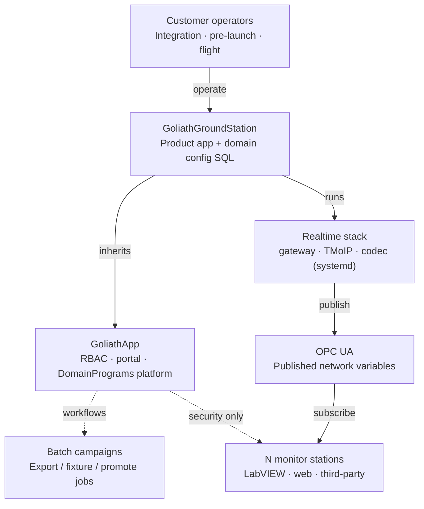
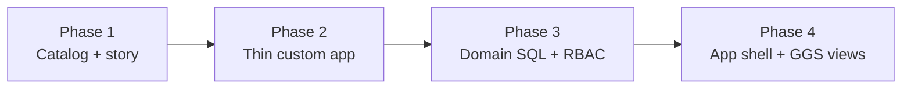

# GoliathGroundStation conversion plan

Customer-facing plan: how Astra becomes a GoliathApp specialization with a singleton rocket gateway, OPC fan-out to N monitor stations, and platform security without turning live telemetry into task workers.

**Sources:** [astra-ground-station-py](https://github.com/Goliath-Research/astra-ground-station-py), [GoliathApp](https://github.com/Goliath-Research/GoliathApp), [GoliathOmics](https://github.com/Goliath-Research/GoliathOmics), [GoliathWeb](https://github.com/Goliath-Research/GoliathWeb).

**Plan notes (2026-10-27).** David’s conversion decisions: dual activation is two-tier (platform first, Ground Station second); DomainPrograms are **required** for this product (including sensor/actuator event logging); Phase 4 is GoliathApp portal shell plus Ground Station–specific views (not optional chrome only), still blocked on the global GoliathApp UI landing in the platform.

## What we can deliver

**Positioning.** GoliathGroundStation is the airspace / launch-ops specialization of GoliathApp — the same platform pattern as GoliathOmics for genomics — while the live rocket path stays publish/subscribe, not claim/submit workers.

A potential customer sees one product under Goliath Research: operator identity and tenancy from GoliathApp, a singleton ground gateway that ingests umbilical or over-the-air telemetry, and any number of LabVIEW or web monitor stations that subscribe to OPC UA variables.

| Capability | Customer value | Platform role |
| --- | --- | --- |
| Singleton rocket gateway | One trusted ingest path for umbilical poll and RF events | Domain service (not a workflow worker) |
| OPC UA variable bus | LabVIEW and other UIs see the same live tags | Publish once; N subscribers |
| N monitor stations | Scale with engines and vehicle variables | OPC clients; optional RBAC who may connect |
| Configurator and test campaigns | Integration and pre-launch configuration | App UI now; **required** DomainPrograms for batch jobs and sensor/actuator event logging |
| Operator security | Sessions, roles, audit without task queues | GoliathApp RBAC / portal shell |

## Architecture

### Product map

Dependency direction matches GoliathOmics: the custom app depends on GoliathApp; realtime utilities do not depend on the app.


### Today (Astra)

Today: `astra-ground-station-py` is a self-contained ground station (Python services + Postgres config/testlog). It does not sit on GoliathApp.

```mermaid
flowchart LR
  rocket(["Vehicle\nUmbilical or RF"])
  tmoip["astra.tmoip\nMinor-frame reassembly"]
  bridge["astra.bridge\nUDP + embedded OPC UA"]
  web["astra.web\nConfigurator / test manager"]
  db[(PostgreSQL\nconfig + testlog)]
  lv["LabVIEW / UIs\nOPC subscribers"]
  exp["astra.exporter\nJobs → testlog"]
  rocket -->|frames| tmoip
  tmoip -->|id || body| bridge
  bridge -->|OPC UA tags| lv
  web -->|psycopg| db
  bridge -.->|config / jobs| db
  exp -->|testlog| db
  web -.->|ops API| bridge
```

### Live data path

**Design rule.** The gateway is a singleton. After ingest, data is published once as OPC network variables. Monitor count scales with engines and vehicle variables. Those stations are not workers waiting for tasks — at most they use platform security for who may connect.


### Target

Target: GoliathGroundStation owns the product surface and domain SQL; GoliathApp supplies identity and the shared workflow/DomainProgram platform; realtime daemons stay sibling services.



### Delivery milestones

Four delivery phases a customer can buy as milestones. Live telemetry never moves into the worker claim loop.



## Phased conversion

1. **Phase 1 — Catalog and customer narrative**  
   Add GoliathGroundStation to GoliathWeb via `.goliath/product.json` (`dependsOn: goliathapp`). Docs site and Academy link. No runtime change to the live path. Days of work; immediate sales collateral.

2. **Phase 2 — Thin custom app around existing Astra services**  
   This repository owns packaging and deploy profiles. Keep `astra.bridge` / `tmoip` / `web` / `exporter` as sibling systemd units. Wire operator login to GoliathApp sessions where useful. Weeks.

3. **Phase 3 — Domain ownership and security**  
   Move config/testlog schema ownership under the custom app (Omics-style domain SQL). Apply RBAC to who may operate the configurator and which OPC tag trees a station may see. **DomainPrograms are required** (not optional): implement exporter and campaign-style batch work (export, fixture, promote) **and** **event logging of sensors and actuators** — the basic variables under analysis during avionics and rocket-engine integration and testing. Months.

4. **Phase 4 — Portal UI (App shell + GGS views)**  
   Inherit the **global GoliathApp portal UI** (still pending on the platform) and add **Ground Station–specific views** on top — replace or wrap the FastAPI configurator with that combined shell. Large UX effort; **blocked on global GoliathApp UI**, not optional chrome-only polish.

### In scope early

- Singleton gateway process
- OPC publish once, N monitors
- Platform identity without task queues
- Required DomainPrograms (batch + sensor/actuator event logging)

### Explicitly out of scope for the live path

- Turning the bridge into a claim/submit worker
- Rewriting the ~350KB config schema into Meta on day one
- Forcing LabVIEW through the workflow engine
- One monitor process per variable as a leased task

### Rough effort bands

| Phase | Effort |
| --- | --- |
| Phase 1 | Days — collateral ready |
| Phase 2 | Weeks — runnable product shell |
| Phase 3 | Months — domain + security depth |
| Phase 4 | Large — App shell + GGS-specific views (blocked on global GoliathApp UI) |

## What stays outside the workflow engine

GoliathApp workers wait for leased ACTION nodes. The ground gateway does not. It either polls the vehicle on the umbilical or receives an over-the-air transmission as an event, then publishes OPC variables. Monitor stations subscribe; their count tracks engines and vehicle variables, not a worker pool size.

**Dual activation is two-tier** (batch and event work only — **not** the live OPC path). Live OPC telemetry stays outside claim/submit.

| Tier | Scope | Pattern | Tracking |
| --- | --- | --- | --- |
| **1 (first)** | GoliathApp + `goliath-gateway` | Shared **notify via pub/sub, own via claim** | [GoliathApp #22](https://github.com/Goliath-Research/GoliathApp/issues/22) |
| **2 (second)** | GoliathGroundStation on tier 1 | Product-specific DomainPrograms and batch/event hooks | [GoliathGroundStation #3](https://github.com/Goliath-Research/GoliathGroundStation/issues/3) |

[GoliathOmics #67](https://github.com/Goliath-Research/GoliathOmics/issues/67) remains a spike for the same platform pattern in genomics. Umbilical poll remains the safety net for ingest timing on the ground path.

- **Use GoliathApp for security and tenancy**
  - Operator sessions and roles
  - Which stations may subscribe to which tag trees
  - Audit of configuration changes
- **Use DomainPrograms for batch work and integration event logging** (required for Ground Station)
  - Event logging of sensors and actuators (variables under avionics / engine integration test)
  - Test-log export jobs
  - Fixture / oracle campaigns
  - Config promote between sites
- **Keep as long-running domain services**
  - Singleton bridge / gateway
  - TMoIP reassembly
  - Embedded OPC UA server
  - Live configurator API until Phase 4

## Customer deliverables checklist

Status as of the plan date — mark done when a phase ships.

- [x] Product page and dependsOn hierarchy on GoliathWeb (Phase 1 — [GoliathWeb #4](https://github.com/Goliath-Research/GoliathWeb/issues/4))
- [x] GoliathGroundStation repository and product.json (Phase 1–2)
- [x] Deploy profile: singleton gateway + OPC + N monitors (Phase 2)
- [x] Operator identity via GoliathApp RBAC (Phase 2–3) — [operator-identity](operator-identity.md) + deploy `operators` block; **library** session middleware + OPC tag-tree ACL (`goliathgroundstation.operator_identity`, `opc_tag_tree_acl`); live mount on sibling **goliath-ground-web** FastAPI still pending
- [x] Domain SQL ownership for config / testlog (Phase 3) — [`database/schema/`](../database/schema/), [`docs/domain-sql.md`](domain-sql.md), [`scripts/apply_domain_schema.sh`](../scripts/apply_domain_schema.sh)
- [ ] **Required** DomainPrograms (Phase 3): sensor/actuator event logging plus export / fixture / promote campaigns — not live OPC
- [ ] Dual activation **tier 1** — GoliathApp + `goliath-gateway`: notify via pub/sub, own via claim ([GoliathApp #22](https://github.com/Goliath-Research/GoliathApp/issues/22); [GoliathOmics #67](https://github.com/Goliath-Research/GoliathOmics/issues/67) spike)
- [ ] Dual activation **tier 2** — GoliathGroundStation on tier 1: product-specific DomainPrograms / event batch ([GoliathGroundStation #3](https://github.com/Goliath-Research/GoliathGroundStation/issues/3))
- [ ] Portal UI: global GoliathApp shell + Ground Station–specific views (Phase 4; blocked on global App UI)

**Pitch line.** Same GoliathApp foundation as our genomics product — specialized for launch ops — with a singleton rocket gateway and OPC fan-out to as many monitor stations as your engines and vehicle require.
