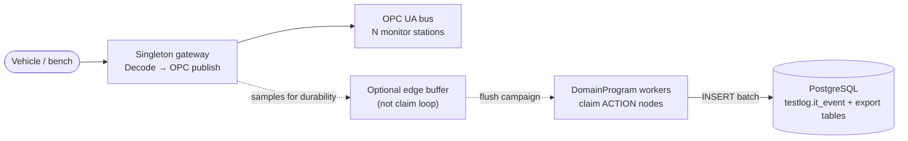

# DomainPrograms (GoliathGroundStation)

GoliathGroundStation **requires** [GoliathApp](https://github.com/Goliath-Research/GoliathApp) DomainPrograms for batch integration-and-test (I&T) work. This document is the Phase 3 design slice ([issue #8](https://github.com/Goliath-Research/GoliathGroundStation/issues/8)): schemas, program stubs, and action intent — not a full worker runtime in this repository.

## What DomainPrograms cover

| Area | Role | Live OPC? |
| --- | --- | --- |
| **Sensor / actuator / system event logging** | Durable capture of variables under analysis during avionics and rocket-engine I&T | No — batch flush into `testlog.it_event` |
| **Test-log export campaigns** | Batch jobs that populate legacy `testlog.l2r_*` / `testlog.r2l_*` tables | No |
| **Fixture / oracle campaigns** | Apply named config fixtures and record validation | No |
| **Config promote** | Site-to-site promotion after validation | No |

Operator configuration and realtime monitoring stay on the **singleton gateway → OPC UA** path and the configurator API until optional portal UI (Phase 4).

## Boundary vs live OPC

**Rules:**

- Live telemetry is **publish/subscribe** on OPC. It does **not** enter `wf` claim/submit or lease ACTION nodes per tag update.
- DomainPrograms **own durable I&T event capture** and **batch analysis** (export, fixture, promote).
- A future edge component may **buffer** high-rate samples locally; a **batch logger** program (worker) flushes into `testlog.it_event`. That flush is workflow work, not OPC fan-out.

## Sensor / actuator event logging model

Legacy Astra export tables (`testlog.l2r_*`, `testlog.r2l_*`) store **wide variable snapshots** per test configuration. For normalized, time-ordered I&T events we extend **`testlog`** with [`it_event`](../database/schema/04_it_event_log.sql):

| Column | Meaning |
| --- | --- |
| `occurred_at` | Event time (UTC) on vehicle, bench, or source clock |
| `source` | `sensor` \| `actuator` \| `system` |
| `tag_id` / `tag_name` | Stable id and human/OPC name |
| `value_json` / `value_numeric` / `value_text` | Typed value (at least one required) |
| `test_id` | Optional link to config test scope |
| `campaign_id` / `run_id` | Optional campaign and workflow run correlation |
| `operator_id` / `session_id` | Optional GoliathApp portal operator context |
| `ingest_batch_id` | Optional flush batch from `ground.it_event_flush_batch` |
| `idempotency_key` | Optional dedupe on replay |

Apply order: GoliathApp platform schema, then domain scripts including `04_it_event_log.sql` ([`scripts/apply_domain_schema.sh`](../scripts/apply_domain_schema.sh)).

## Program stubs

Stub JSON lives under [`domain_programs/`](../domain_programs/). Each file is **`programVersion: 2`** IR aligned with [GoliathOmics domain fixtures](https://github.com/Goliath-Research/GoliathOmics/tree/main/workflow_engine/domain/fixtures) and validates against [`schemas/domain/domain_program.schema.json`](../schemas/domain/domain_program.schema.json) (copied from Omics for offline validation).

| File | Intent |
| --- | --- |
| `sensor_actuator_event_logger.program.json` | Collect buffered samples → flush batch to `testlog.it_event` |
| `testlog_export_campaign.program.json` | Prepare / run / finalize exporter campaign |
| `config_fixture_promote_placeholder.program.json` | Fixture apply → site promote placeholder |

**Platform compile/seed:** not run in this repo yet. Treat stubs as the contract for action names and step graph until workers and `goliath-cfg` catalog seed land.

## Mapping to GoliathApp actions and workers

Patterns from [GoliathApp actions.md](https://github.com/Goliath-Research/GoliathApp/blob/main/docs/actions.md) and [workflow-engine.md](https://github.com/Goliath-Research/GoliathApp/blob/main/docs/workflow-engine.md):

1. Each program step **`action`** (or **`do`**) names a row in **`wf.workflow_action`** (`action_name`).
2. Workers register **`capabilities`**; the gateway offers READY **ACTION** nodes whose `capability` matches.
3. Claim returns **`input_json`**; submit returns **`result_code`** and **`output_json`**; SQL continues the instance.

Ground-station handlers will live in a future worker package (not cloned from Astra in this slice).

### Intended action catalog

Document-only until seed SQL is wired to `wf.wf_repo_upsert_workflow_action` on a test bed:

| `action_name` | `capability` | Purpose |
| --- | --- | --- |
| `ground.it_event_collect_buffered` | `ground.it_event` | Read local/edge buffer; produce staging ref for flush |
| `ground.it_event_flush_batch` | `ground.it_event` | INSERT into `testlog.it_event`; emit `ingestBatchId` |
| `ground.testlog_export_prepare` | `ground.testlog_export` | Build export plan from config + profile |
| `ground.testlog_export_run` | `ground.testlog_export` | Write legacy testlog tables |
| `ground.testlog_export_finalize` | `ground.testlog_export` | Mark campaign complete, audit metadata |
| `ground.config_fixture_apply` | `ground.config_campaign` | Apply fixture; validation report ref |
| `ground.config_promote_site` | `ground.config_campaign` | Promote config to target site |

Optional seed template (run manually after platform apply): [`database/schema/05_domain_action_catalog.sql`](../database/schema/05_domain_action_catalog.sql).

## Activation: claim today; dual wake later

**Out of scope for this slice:** dual activation (pub/sub wake + claim) for DomainPrograms.

- **Today:** event-driven or timer-driven campaigns **start via the normal claim loop** (operator or scheduler creates a workflow instance; workers claim ACTION nodes).
- **Later:** tier-2 pub/sub wake to reduce latency when events fire ([GoliathApp #22](https://github.com/Goliath-Research/GoliathApp/issues/22), [GoliathGroundStation #3](https://github.com/Goliath-Research/GoliathGroundStation/issues/3)). Documented here so stubs do not assume `on:` event triggers are wired in production yet.

The **`event_wait_ack`**-style `on:` / `wait:` blocks in Omics fixtures illustrate future fast-start patterns; ground-station stubs intentionally omit `on:` until tier 2 lands.

## Phase 3 checklist (this slice)

| Item | Status |
| --- | --- |
| Design doc (this file) | Done |
| `testlog.it_event` DDL | Done — [`04_it_event_log.sql`](../database/schema/04_it_event_log.sql) |
| Program stubs | Done — [`domain_programs/`](../domain_programs/) |
| Action catalog notes | Done — table above + `05_domain_action_catalog.sql` |
| JSON schema smoke tests | Done — [`tests/test_domain_program_stubs.py`](../tests/test_domain_program_stubs.py) |
| Workers implement handlers | **Not done** — awaits ground worker package |
| Platform compile/seed programs | **Not done** |
| Dual activation | **Not done** — [#3](https://github.com/Goliath-Research/GoliathGroundStation/issues/3) |

See also [conversion-plan.md](conversion-plan.md) customer checklist.
