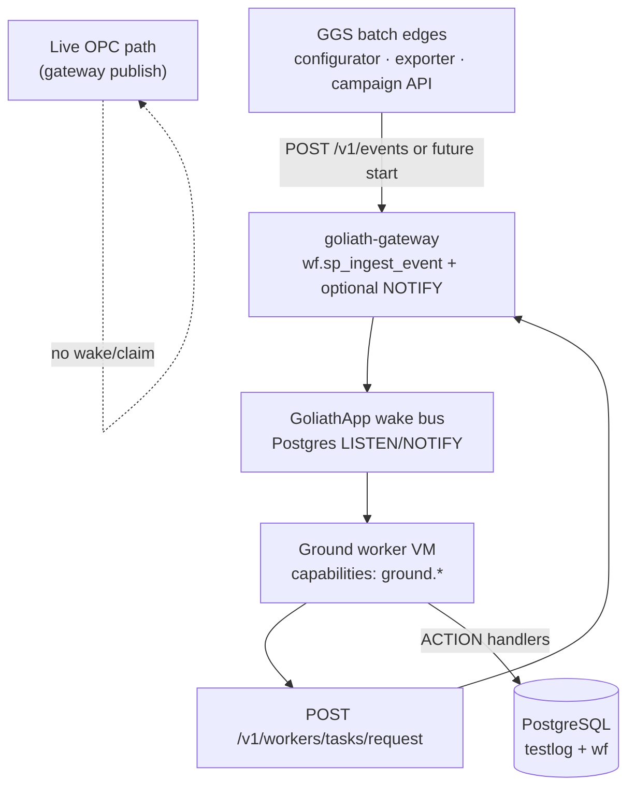

# Dual activation — tier 2 (GoliathGroundStation)

GoliathGroundStation **product mapping** for dual worker activation on top of the shared platform in [GoliathApp `docs/dual-activation.md`](https://github.com/Goliath-Research/GoliathApp/blob/main/docs/dual-activation.md) ([GoliathApp #22](https://github.com/Goliath-Research/GoliathApp/issues/22)).

**Tier 1 (platform, done in GoliathApp):** Postgres `NOTIFY`/`LISTEN` wake broker (opt-in `WF_WAKE_POSTGRES=1` / `WORKER_WAKE_POSTGRES=1`), `WorkerWakeMessage` DTO, channel prefix `goliath.wake.v1.{pool|capability|program}.*`, gateway hook `publish_wakes_after_event_ingest` after `POST /v1/events`.

**Tier 2 (this doc):** which GGS DomainPrograms and edges publish wakes, how channel choice aligns with program stubs, and where `payload.worker_wake` is attached. **No broker reimplementation in this repository** — GGS depends on goliath-gateway + GoliathApp workers.

Track implementation progress: [GoliathGroundStation #3](https://github.com/Goliath-Research/GoliathGroundStation/issues/3).

## Activation model (unchanged from platform)

| Path | Role |
| --- | --- |
| **Pull / claim** | Safety net and backlog — `POST /v1/workers/tasks/request` (`wf.sp_worker_request_task`) is the **only** lease grant. |
| **Pub/sub wake + claim** | Near-immediate start when batch I&T work becomes READY — gateway publishes a small wake; idle workers LISTEN, then **still claim**. |

**Notify vs own:** wakes carry no `input_json` and no lease. Losers on claim return idle; duplicate wakes are harmless.

## Hard boundary: live OPC vs DomainPrograms

| Traffic | Path | Dual activation? |
| --- | --- | --- |
| Umbilical poll, RF decode, gateway → OPC UA publish | Singleton gateway, N monitor subscribers | **Never** — not claim/submit, not wake |
| High-rate tag updates | OPC pub/sub only | **Never** |
| Buffered I&T sample flush, export campaigns, fixture/promote | DomainProgram ACTION nodes on GoliathApp workers | **Yes** — wake optional hint; claim authoritative |

Live telemetry **must not** enter `wf` ingest solely to wake workers per tag. Durable work starts when an operator, scheduler, or **batch edge** creates a workflow instance (event ingest or future portal start) with optional `worker_wake` hints.



## DomainPrograms that publish wakes

Program **`name`** in [`domain_programs/`](../domain_programs/) is the tier-2 **`program_id`** for wakes until catalog slugs are seeded in GoliathApp.

| Program (`program_id`) | Stub file | Batch work | Typical start edge |
| --- | --- | --- | --- |
| `GroundItEventLogger` | `sensor_actuator_event_logger.program.json` | Collect edge buffer → flush `testlog.it_event` | Campaign “flush now”, timer, or `ground.it_event.buffer_threshold` event |
| `GroundTestlogExportCampaign` | `testlog_export_campaign.program.json` | Prepare / run / finalize legacy `testlog.l2r_*` / `r2l_*` export | Configurator or ops API “start export” (successor to `astra.exporter` jobs) |
| `GroundConfigFixturePromote` | `config_fixture_promote_placeholder.program.json` | Fixture apply → site promote | Configurator “run fixture campaign” / promote approval |

**Sensor/actuator/system event logging** is **durable I&T capture** (flush batches into `testlog.it_event`), not live OPC fan-out. The gateway may **enqueue** samples for a flush campaign; only the DomainProgram worker **claims** flush actions.

See [domain-programs.md](domain-programs.md) for action names and OPC boundary.

## Channel choice (pool vs capability vs program)

GoliathApp publishes to **one channel per dimension set** on the wake message (see [`wake_channels_for_message`](https://github.com/Goliath-Research/GoliathApp/blob/main/goliath_worker/wake.py)).

GGS convention for tier 2:

| Dimension | Value | When to use |
| --- | --- | --- |
| **Pool** | `ground-station` | Default fleet enrollment for all ground batch workers on a site. Publish on every GGS batch wake so the whole pool can interrupt idle wait. |
| **Capability** | `ground.it_event`, `ground.testlog_export`, or `ground.config_campaign` | Narrow wake to workers that advertise that capability (matches [`05_domain_action_catalog.sql`](../database/schema/05_domain_action_catalog.sql)). **Preferred primary narrow** for each program’s first READY action. |
| **Program** | Same as program `name` (e.g. `GroundItEventLogger`) | Optional third publish when only one program’s instances should wake workers (reduces unrelated claims on shared pools). |

**Recommended publish set per program** (logical channels):

| `program_id` | `capability` | Also publish |
| --- | --- | --- |
| `GroundItEventLogger` | `ground.it_event` | `pool: ground-station`, `program: GroundItEventLogger` |
| `GroundTestlogExportCampaign` | `ground.testlog_export` | `pool: ground-station`, `program: GroundTestlogExportCampaign` |
| `GroundConfigFixturePromote` | `ground.config_campaign` | `pool: ground-station`, `program: GroundConfigFixturePromote` |

Workers enrolled in `ground-station` with matching capabilities should subscribe via GoliathApp `wake_channels_for_enrollment` (pool + capabilities + optional program binding). **Claim** still matches READY nodes by capability.

Helper in this repo (design slice): [`worker_wake_hints_for_program()`](../src/goliathgroundstation/worker_wake.py) returns the same logical channel list as GoliathApp channel helpers for known program ids.

## Attaching `payload.worker_wake` at GGS edges

Gateway parsing uses key **`worker_wake`** on the event payload ([`WAKE_PAYLOAD_KEY`](https://github.com/Goliath-Research/GoliathApp/blob/main/workflow_engine/rest/worker_wake.py)). GGS edges should set hints when ingest creates or advances instances (`applied_count > 0`, non-duplicate).

### Shape (aligned with tier 1)

```json
{
  "event_type": "ground.export.start",
  "source": "ggs-configurator",
  "idempotency_key": "export:42:2026-10-27T21:00:00Z",
  "payload": {
    "campaignId": "…",
    "worker_wake": {
      "pool": "ground-station",
      "capability": "ground.testlog_export",
      "program_id": "GroundTestlogExportCampaign"
    }
  }
}
```

Optional `workflow_instance_id` inside `worker_wake` is observability only; it does not grant a lease.

### Edge responsibilities (future wiring; documented here)

| Edge | Event types (illustrative) | Wake profile |
| --- | --- | --- |
| **Configurator / portal** | `ground.it_event.flush`, `ground.export.start`, `ground.fixture.start`, `ground.promote.start` | Use [`worker_wake_hints_for_program(program_id)`](../src/goliathgroundstation/worker_wake.py) or the table above |
| **Exporter successor API** | `ground.export.start` | `GroundTestlogExportCampaign` profile |
| **Gateway ops hook** (batch only) | `ground.it_event.buffer_ready` | `GroundItEventLogger` — **not** emitted on OPC tag read |
| **Scheduler / cron** | Timer-started instances | Same profiles; claim remains safety net if wake lost |

Portal or GGS HTTP layers **do not** call Postgres `NOTIFY` directly. They either:

1. **`POST /v1/events`** through goliath-gateway with `payload.worker_wake`, or  
2. Call a future gateway “start instance” route that internally uses `publish_wakes_after_event_ingest` or a sibling helper (same DTO).

### `wake_id` / `reason` conventions (GGS)

Gateway tier 1 uses `wake_id = event:{event_id}:{idempotency_key}` and `reason = event_ingest:{event_type}`. GGS adapters should keep **stable idempotency keys** per campaign start so duplicate ingests dedupe wakes and workflow rows.

## Event types vs workflow graph (not wired in this slice)

Tier 2 **does not** require `on:` / `wait:` blocks in program JSON yet. Expected flow:

1. Edge ingests event → `wf.sp_ingest_event` creates/advances instance → READY ACTION for e.g. `ground.testlog_export_prepare`.
2. Gateway publishes wake (when `WF_WAKE_POSTGRES=1`).
3. Worker wakes → claims → runs stub actions from [domain program stubs](../domain_programs/).

Event-type → program mapping is product configuration (future `wf` event rules); this document fixes **wake channel** alignment with stubs.

## Dependencies and non-goals

| Item | Owner |
| --- | --- |
| Wake broker, LISTEN/subscribe, claim SQL | GoliathApp / goliath-gateway |
| Ground ACTION handlers, worker package | Future GGS worker repo or package — **not** this slice |
| Redis / NATS wake bus | Optional later; same logical channels |
| Reimplementing `publish_wakes_after_event_ingest` in GGS | **Rejected** |

## Rollout checklist (tier 2)

| Step | Status |
| --- | --- |
| GGS mapping doc (this file) | **Done** (design slice) |
| Cross-links from domain-programs / conversion-plan | **Done** (design slice) |
| `worker_wake_hints_for_program` helper + tests | **Done** (design slice) |
| Configurator/exporter attach `worker_wake` on real ingest | Not done |
| Ground workers subscribe + claim with `WORKER_WAKE_POSTGRES=1` | Not done |
| End-to-end flush/export campaign on test bed | Not done |

## Related

- [domain-programs.md](domain-programs.md) — programs, actions, OPC boundary  
- [conversion-plan.md](conversion-plan.md) — customer checklist  
- [GoliathApp dual-activation.md](https://github.com/Goliath-Research/GoliathApp/blob/main/docs/dual-activation.md) — tier 1 platform  
- [GoliathGroundStation #3](https://github.com/Goliath-Research/GoliathGroundStation/issues/3) — tier 2 tracking issue
